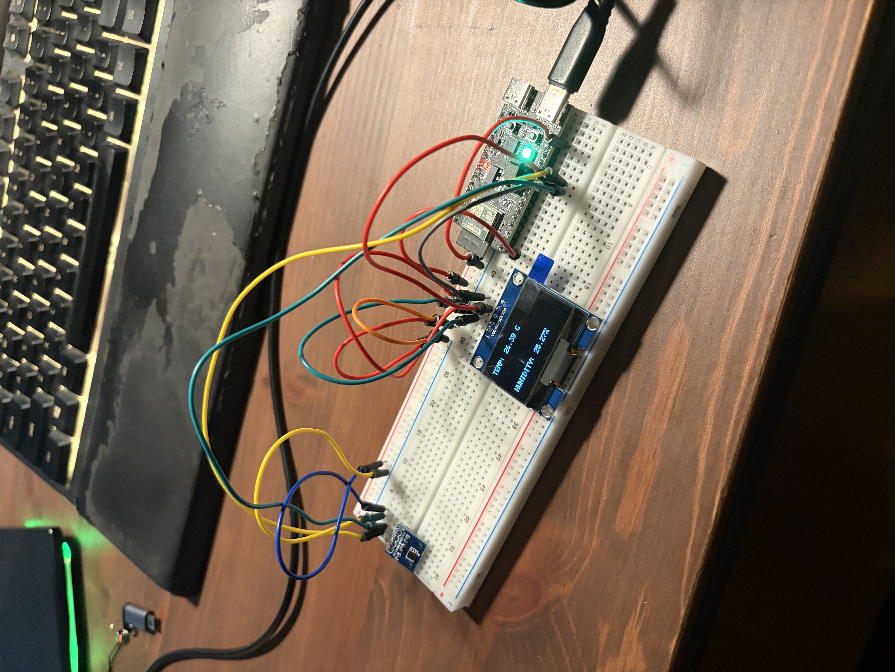
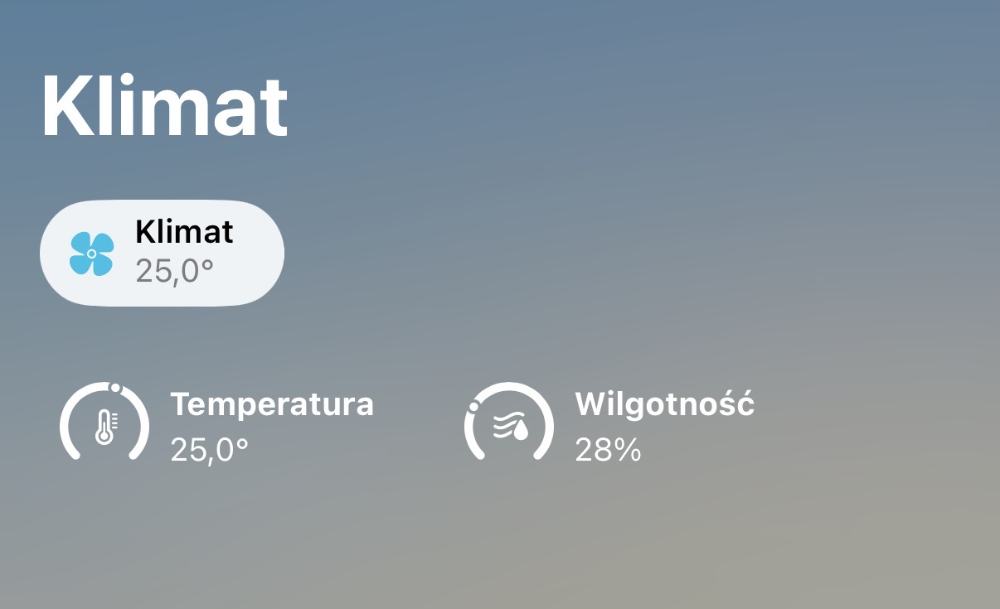

# Smart Thermometer

A DIY Apple Home smart thermometer, built from parts I already had. I started with a breadboard prototype to learn embedded development and connect a temperature and humidity sensor to Apple Home using Matter. The project is now running on an ESP32-C6, with a display for local readings.

This project simply aims my need for a thermometer to monitor temperature at home. Instead of buying one, I decided to develop and manufacture thermometer that can be connected to Apple Home.

The long term goal is to design a custom PCB, running on a battery and chargable with USB.

## HW/SW stack

- ESP32-C6
- Matter
- HTU31
- SH1106 OLED
- ESP-IDF

## Development process

The first prototype used:

- an NUCLEO-L476RG board,
- a 1.3-inch, 128 × 64-pixel I²C OLED display,
- a BMP280 barometer with a built-in temperature sensor,
- a HTU31D thermometer with humidity sensor,
- a breadboard,
- jumper wires.

The second step of development was usage of esp32-c6 to connect the firmware with Apple Home over Matter. However, after connecting ESP to the Apple Home, it turned out that the information about the pressure is not displayed by Apple Home, so BMP280 is becoming useless. Additionally, STM32 does very little work - only communication with oled and htu31.

The decision was to drop STM32 entirely and base the whole program on ESP32 only. 

